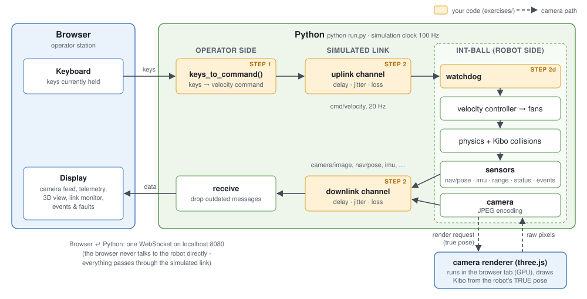

# Space Robotics Teleop Simulation

Hands-on exercises on teleoperation for the THA course *Emerging Technologies*.
You fly JAXA's free-flying camera robot **Int-Ball2** through the Japanese
module *Kibo* of the ISS - first directly, then over a link with delay, jitter
and packet loss.



The browser is only the operator station: it sends the keys you hold and shows
what arrives over the downlink. Everything else runs in Python - your code
(orange) sits between the keyboard and the robot. The camera image is drawn by
the browser's GPU from the robot's true pose, then goes back to Python and through
the downlink like any other sensor message.

## Setup

You need **Python 3.10 or newer** and **Chrome or Firefox**.

```bash
git clone <repo-url> teleop-lab
cd teleop-lab
python3 -m pip install -r requirements.txt      # numpy, aiohttp, Pillow
python3 run.py --step 0
```

> **Windows:** type `python` (or `py`) instead of `python3` in all commands.

Open <http://localhost:8080>. Click once into the page, then fly with the keyboard.
Keep the terminal next to the browser: experiment settings, and
errors from your code show up there.

## Steps

| Step | Run | You implement | Check |
|---|---|---|---|
| 0 Tour | `python3 run.py --step 0` | nothing - fly through Kibo to the airlock at the far end | |
| 1 Direct teleop | `python3 run.py --step 1` | `exercises/step1_command_mapping.py` | `python3 check.py 1` |
| 2 The channel | `python3 run.py --step 2 --delay 1000` | `exercises/step2_channel.py` | `python3 check.py 2` |
| 3 Feel the delay | `python3 run.py --step 3 --delay 0` (then 300, 1000, 3000) | experiment: do the inspection task at each delay | <http://localhost:8080/results> |

Stuck on a step? `python3 run.py --step 3 --solution 2` uses the reference
channel so you can continue.

## The operator station

The browser page is the system you work on: it shows only what an operator of
the real Int-Ball would see - everything that came down the (simulated) link.

| Element | What it shows |
|---|---|
| **Main camera** | JPEG frames from Int-Ball's front camera after the downlink. Top right: resolution, size per frame, frame rate as received. *image age*: how old the picture is (now − time it was taken). *NO SIGNAL*: no frame for 1.5 s. |
| **Telemetry** (below the camera) | From `nav/pose`, `status` and `range`: position, speed, attitude, battery, collisions, *cmd age* (how long ago the robot received its last command). The numbers are averaged and refreshed 4× per second. Bars: distance to the nearest surface in six directions - red below 0.15 m. |
| **3D view** | A model of Int-Ball placed at the last *received* pose inside Kibo, with its trail. *follow* keeps the view behind the robot. |
| **Link monitor** | Per topic, measured over the last 2 s: messages per second, data rate, latency (receive time − send time) and loss. ↓ downlink (robot → you), ↑ uplink (you → robot). |
| **Events & faults** | Collisions reported by the robot, and exceptions raised by your code (file and line). |
| **Status bar** | Connection to Python, the velocity command your `keys_to_command` produced, and the keys currently held. |

## Command line

Everything about the experiment is set when you start the code. To change a
setting, press Ctrl+C and start again - the open browser tab reconnects by
itself. `python3 run.py --help` lists all options.

| Option | Meaning |
|---|---|
| `--step N` | exercise step 0..3 |
| `--solution 1,2` | use the reference solution for these exercises; with a letter only up to that sub-task, e.g. `--solution 2b` = delay + jitter (files in `solutions/step1/`, `solutions/step2/`) |
| `--delay MS`, `--jitter MS`, `--loss PCT` | link properties (from step 2 on - before that the link is ideal) |
| `--outage START:DUR` | link down for DUR seconds, START seconds after your first key press; can be repeated |
| `--camera WxH`, `--fps F`, `--quality Q`, `--gray` | camera stream (default 800x600, 10 fps, JPEG quality 75) |
| `--course` | timed inspection task (always on in step 3, see below) |
| `--truth` | show the simulator's ground truth in the 3D view (not available in reality) |

## The inspection task (step 3)

Int-Ball's job on the ISS is to film for the ground team. Your task: fly from
the hatch to the **JEM airlock** at the far end of Kibo and inspect it - stop
0.5-1 m in front of it, facing it, roughly centred in the module, and hold
still for 2 s. The clock starts with your first key press; the terminal tells
you when you are in position and prints the result (time, collisions, path
length, idle time, number of waits), which is also saved to `results/runs.csv`.

## Controls

| Key | Motion | Key | Motion |
|---|---|---|---|
| W / S | forward / back | Q / E | yaw left / right |
| A / D | left / right | ↑ / ↓ | look up / down |
| R / F | up / down | | |

## Repository layout

```
run.py            start the lab
check.py          automatic checks for your exercises
exercises/        <- your code goes here
teleop/           framework: simulation, robot side, operator side, server
web/              operator UI (three.js)
assets/intball2/  Int-Ball2 3D model (JAXA)
results/          your course runs (CSV)
```

## Credits

Int-Ball2 model and inertia parameters: JAXA, from the
[Int-Ball2 simulator](https://github.com/jaxa/int-ball2_simulator).
Kibo interior: cut out of an ISS interior model with `tools/build_kibo.py`
3D rendering: [three.js](https://threejs.org) (MIT).
